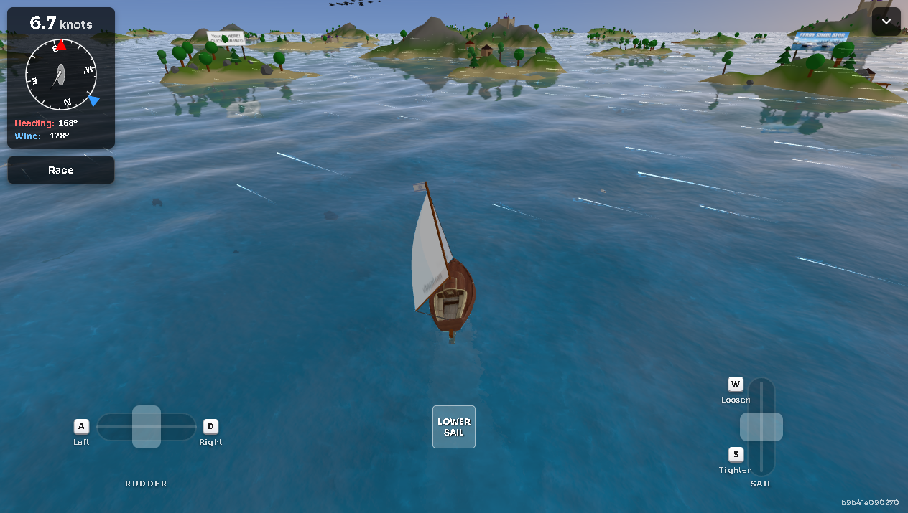

# VIBESAIL — offline mirror

Full mirror of **VibeSail** (https://vibesail.com/) — "Free Online Sailing
Simulator & Game".

Source: https://vibesail.com/



## Stack

- **Vite multi-page production build** — 108 HTML documents (home, `/game`,
  `/world`, `/race`, `/leaderboard`, `/highsea`, `/tutorial`, `/daily-race`,
  `/blog/…` + 80 changelog posts, `/lang/<code>/` homepages) sharing a hashed
  `assets/*.js` chunk graph (modulepreload polyfill, auth/profile clients,
  Preact-style runtime chunks, per-route chunks).
- **three.js in the chunk graph** — the bundled engine (`three.module-…`) plus
  its GLTFLoader/DRACOLoader/MTLLoader addons and the Google Draco decoder run
  from local files.
- **MapLibre GL + Leaflet** in the `/world` chunk — the world map page bundles
  both engines (a worker module is served from `/maplibre/`).
- **Web Audio + PWA + i18n** — nine looped/one-shot MP3s, `manifest.webmanifest`
  + a service worker, and a 14-language JSON i18n layer under `/i18n/`.

## What this is

VibeSail is a free browser 3D sailing simulator: you helm a sailboat with real
sail-trim, heel and wind-angle fundamentals, sail a free-sail world of islands,
join a daily race, run the guided tutorial, push into High Sea, and explore a
world map of real cities (Google 3D tiles) with other sailors' boats on the
water. Vite multi-page build whose game chunk carries the three.js renderer and
model loaders. Captured whole — entry, all 108 pages, the full chunk graph, the
model/texture/audio/font payloads, the Draco decoder, the MapLibre worker, the
country-flag family and the i18n JSONs: 410 files, ~18.7 MB, byte-exact
(`.upstream/manifest.json`).

External at runtime (never captured, never backfilled — documented gaps):

- **Live account + game backend** — `auth.vibesail.com` (accounts/sessions),
  `api.vibesail.com` (ghosts, records, best-times, daily-race/high-sea runs,
  profile stats) and `geo.vibesail.com` (city models, e.g.
  `/geo/positano-hd/mesh.glb`); the game boots and sails offline, multiplayer
  and leaderboard data do not.
- **Analytics + third-party** — PostHog (`us.i.posthog.com`,
  `us-assets.i.posthog.com`), Google Tag Manager, Simple Analytics
  (`simple.vibesail.com`), Ahrefs, OneSignal SDK (`cdn.onesignal.com`),
  Cloudflare Turnstile, Google 3D tiles (`tile.googleapis.com`), Google Fonts
  CSS, Stripe payment links, social embeds.

## Layout

- `.upstream/manifest.json` — sha256 for every captured file
- `readable/` — prettified derived layer (pinned prettier 3.9.6): 87 JS/MJS
  pretties, 15 CSS pretties and 339 inline-block twins
- `src/` + `split-spec.json` — statement-aligned slices of the app chunks
  (224 slices) with the recorded derivation spec
- `tools/capture.mjs` — capture crawler (sitemap seeds → closure to fixpoint)
- `tools/derive.mjs` — rebuild `readable/` + `src/` + `split-spec.json`
- `tools/update.mjs` — read-only drift probe against the live site
- `tools/verify.mjs` — re-hash the capture against the manifest
- `tools/audit.js` — integrity gate for the derived layers (`AUDIT PASS`)
- `_mirror-report.json` — capture record (paths, 404s, external hosts)
- `docs/` — boot + gameplay evidence screenshots

Capture layer layout: the site is served at the origin root, so the capture
sits at the repo root — `/assets/x.js` → `assets/x.js`, `/game` →
`game/index.html` (directory index), `/lang/de/` → `lang/de/index.html`.

## Assets

- **models** — 3 file(s): `assets/models/boat_models/venice/model_lowpoly_optimized.glb`
  (the playable boat), `assets/models/cargo_ships/low_poly_cargo_ship.glb`,
  `assets/models/landmarks/starship_upper.glb`
- **textures** — 3 file(s): `textures/waternormals.jpg`, `textures/cloud.avif`,
  `textures/sky/tropical_day.jpg`
- **audio** — 9 file(s): `sounds/` (e.g. boat_waves-6099.mp3,
  wood-creaking-30692.mp3, saildeploy-99393.mp3, powerful-cannon-shot-352459.mp3,
  happy-relaxing-loop-275536.mp3)
- **fonts** — 38 file(s): `assets/` (Fraunces 500/600/700 woff/woff2 subsets and
  the site page fonts)
- **images** — 129 file(s): `assets/thumbnail.png` (OG image, 4.5 MB),
  `assets/blog/<slug>/cover.webp` (per-post covers),
  `assets/flags/pirate.png` + `assets/flags/unknown.png` +
  `assets/flags/countries/` (58 country flags),
  `assets/sponsored-locations/` (8), `assets/world-signs/` (31 signs),
  `assets/cities/` (11 city thumbnails), `assets/icons/` (PWA icons),
  `favicon.ico`
- **data** — 22 file(s): `i18n/` (14 language JSONs + config.json),
  `version.json`, `manifest.webmanifest`, `sitemap.xml`, `robots.txt`
- **vendor** — 9 file(s): `assets/three.module-BgyKfsEV.js`,
  `assets/GLTFLoader-C2oC7w8g.js`, `assets/DRACOLoader-XlKGmd74.js`,
  `assets/MTLLoader-Dw3w9IRM.js`, `assets/draco/` (decoder js + wasm + wrapper),
  `maplibre/` (worker + shared); plus the vendor-dominated `/world` chunk
  `assets/world-DPn3WgXw.js` (Leaflet 1.9.4 + MapLibre GL + app code, indexed
  whole-file — see split-spec.json)

## Run

Open the capture through any static file server that resolves directory
indexes (the site's clean URLs, e.g. `/game`, map to `game/index.html`):

```
npx serve .
```

Then open `http://localhost:3000/` (or `/game` for the game). The 3D game,
sail physics, tutorial and world map run fully from the mirror; account,
leaderboard and geo-model features call the external backends above.

## Verify

```
node tools/verify.mjs     # re-hash the capture against the manifest
node tools/audit.js       # derived-layer integrity gate (AUDIT PASS)
```

## Updating from upstream

```
node tools/update.mjs     # read-only drift probe: what changed upstream
```

The probe never rewrites the capture — a mirror is a point-in-time snapshot.
`tools/capture.mjs` can re-crawl the live origin (sitemap seeds → closure
fixpoint); a refresh means re-running it into a clean tree, copying replaced
files to `legacy/<date>/` first, re-cutting the manifest, and re-deriving
`readable/` + `src/` with `node tools/derive.mjs`.

### 2026-10-13 capture + readable/src derivation

- **Capture** — `tools/capture.mjs` seeded from `/sitemap.xml` (108 pages) +
  `robots.txt`/`manifest.webmanifest`/`favicon.ico`, then iterated the closure
  to fixpoint (HTML refs, `import`/`import()`, `__vite__mapDeps` tables,
  `new URL`, AST-extracted asset literals, CSS `url()`, JSON refs). Runtime
  cross-checked with an opencli browser network log while the game sailed:
  that pass found files no literal scan can see — the country-flag family
  (58 PNGs built from the countries table), the image-sky texture
  (`/textures/sky/tropical_day.jpg`), the cloud texture (`/textures/cloud.avif`),
  the Draco decoder set behind `setDecoderPath('/assets/draco/')`, the MapLibre
  worker pair (`/maplibre/maplibre-gl-worker.mjs` + `-shared.mjs`) and three
  `assets/sponsored-locations/*.webp` logos — all of which are now captured.
  410 files, 18,687,829 bytes. Genuine 404s (recorded in `_mirror-report.json`,
  category noise like alternate spellings of chunk names) and live-backend
  endpoints (`api.`/`auth.`/`geo.vibesail.com`, `tile.googleapis.com`) are
  documented gaps, not captured.
- **readable/** — pinned prettier 3.9.6 (module API, default options,
  format-to-layout-fixed-point, never the CLI) rendered the 87 captured JS/MJS
  chunks to `*.pretty.js` (including `maplibre/*.mjs`), the 15 stylesheets to
  `*.pretty.css`, and 339 inline `<script>` blocks from the 108 HTML pages to
  `readable/<page>-inline-N.pretty.js` twins (byte ranges + sha256 recorded in
  `readable/index-inline-map.json`); 94 typed data blocks
  (`application/ld+json` VideoGame/FAQ schema) are `notRendered` records.
- **src/** — 224 statement-aligned slices (`src/<tag>-NN.js`, exact 2-line
  provenance header) across the 78 app chunks: 224/224 parse standalone
  (`node --input-type=module --check -`) and round-trip byte-exact to their
  readable line ranges; 62 skipped sections (final `export {…}` tables) and 363
  wholeFile sections (vendor + stylesheets + inline twins) are indexed, not
  sliced. The minifier merged the bundled Leaflet 1.9.4 + MapLibre GL engines
  and the `/world` page's own constants into one declaration, so
  `assets/world-DPn3WgXw.js` is classified whole-file (content guards assert
  both engines and the app anchors) — recorded in `split-spec.json`.
- **Gates** — `node tools/verify.mjs` → `410 files checked, 0 problems`;
  `node tools/audit.js` → `AUDIT PASS` (224/224 round-trips, 441/441 pretties
  re-render byte-exact, 433 inline blocks, 238/242 imports resolve + 4
  whitelisted machinery); serve probe — mirror served on loopback, `/`,
  `/game`, `/world`, the game chunk, the Draco decoder, the MapLibre worker,
  the sky texture and the venice boat model all HTTP 200, listener killed and
  the port closed (netstat); boot test + cover in docs/ (the game rendered and
  sailed — 7 knots under sail on the captured build).
- **§0.4 fork-over-mirror** checked 2026-10-13: the page and its JS reference
  no public source repo (only internal build-script names,
  `scripts/generate-localized-homepages.mjs` / `templates/home.html`). A GitHub
  search finds `gurbin/vibesail` — an unrelated Astro+Supabase sailing
  *trip-planner* project with no homepage, not this game — and otherwise only
  directory listings pointing at vibesail.com. No upstream repo to fork, so
  the mirror stands.
- Identifier names in `src/` are the bundle's own minified names — the rename
  campaign (PLAN §5) remains an open task.

## Mirror conventions

- **Capture layer** — the captured files are byte-exact copies of what the
  origin served; nothing in them is edited.
- **Vendor rule** — bundled engines/decoders (`three.module`, the GLTF/DRACO/MTL
  loaders, `assets/draco/`, `maplibre/`, the world chunk, fonts) stay byte-exact
  as served; `readable/` and `src/` never rewrite vendor bytes.
- **Readable layer** — `readable/` is derived (prettified) and never shipped to
  a browser; it exists so the bundle can actually be read.
- **Provenance** — `.upstream/manifest.json` records sha256 for each captured
  artifact, and `tools/verify.mjs` re-checks it.
- **Drift** — `tools/update.mjs` is read-only: it reports what changed upstream
  and never rewrites the capture.

## Fleet status

<!-- mirror-status:start — feeds _standard/REPO-INDEX.md. Update ONLY your own mirror's block; never edit the shared index (PLAN §8). Rebuild: node _standard/build-index.mjs -->
<!-- cols: cls=classification · ver=verify 0 problems · upd=drift probe · man=manifest · rdbl=readable re-derived · src=reversed src · boot=boot test · top=offline-mirror topic · tag=backup tag · staged=staged not committed -->
| # | repo | cls | ver | upd | man | rdbl | src | boot | top | tag | staged |
|---|---|---|---|---|---|---|---|---|---|---|---|
| 304 | vibesail | mirror | ✓ | ✓ | ✓ | ✓ | ✓ | ✓ | ✓ | — | — |
<!-- mirror-status:end -->
